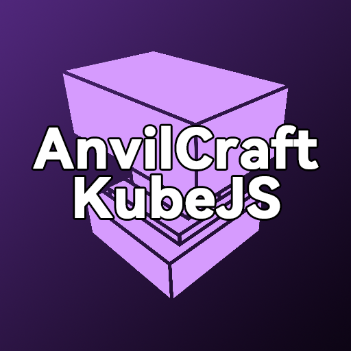

# 铁砧工艺：KubeJS

中文 | [English](./README_en.md)

[][AnvilCraft]

[][Modrinth]
[][CurseForge]

### 许可协议

[][License]

### 资源许可协议

[][Asset License]

[AnvilCraft]: https://www.anvilcraft.dev

[License]: https://spdx.org/licenses/LGPL-3.0-only.html

[Asset License]: https://gist.github.com/Gu-ZT/38961ed5c97500cf61b04ab048fa38ad

[Modrinth]: https://modrinth.com/mod/anvilcraft-kubejs

[CurseForge]: https://www.curseforge.com/minecraft/mc-mods/anvilcraft-kubejs

## 使用许可

* 除非另有说明，否则代码默认许可为 [LICENSE 文件(LGPL-3.0)](./LICENSE)
* 除非另有说明，否则非代码资产默认许可为 [ASSET_LICENSE 文件(ARR)](./ASSETS_LICENSE)

## 使用方法

下载对应版本 `mod` 放入 `mods` 文件夹，启动游戏即可。

## 主要维护者

- [@Gugle](https://github.com/Gu-ZT)
- [@TBPig](https://github.com/TBPig)
- [@QiuShui1012](https://github.com/QiuShui1012)
