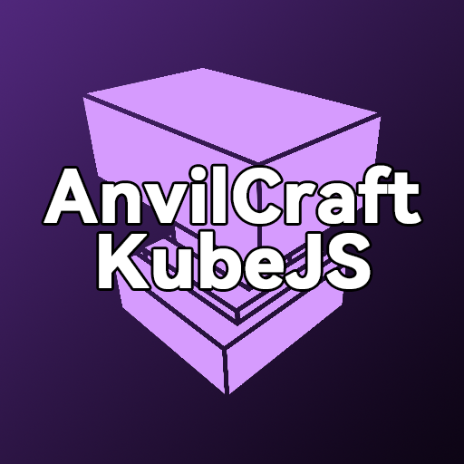

# AnvilCraft: KubeJS

[中文](./README.md) | English

[][AnvilCraft]

[][Modrinth]
[][CurseForge]

### License

[][License]

### Asset License

[][Asset License]

[AnvilCraft]: https://www.anvilcraft.dev

[License]: https://spdx.org/licenses/LGPL-3.0-only.html

[Asset License]: https://gist.github.com/Gu-ZT/38961ed5c97500cf61b04ab048fa38ad

[Modrinth]: https://modrinth.com/mod/anvilcraft-kubejs

[CurseForge]: https://www.curseforge.com/minecraft/mc-mods/anvilcraft-kubejs

## License

* Code unless otherwise stated default to our [LICENSE file(LGPL-3.0)](./LICENSE) here
* Non-Code assets (Located here) go by our [ASSET_LICENSE file(ARR)](./ASSETS_LICENSE) here

## Usage

Download the corresponding version of AnvilCraftMod and place it in the `mods` folder to start the game.

## Maintainer

- [@Gugle](https://github.com/Gu-ZT)
- [@TBPig](https://github.com/TBPig)
- [@QiuShui1012](https://github.com/QiuShui1012)
